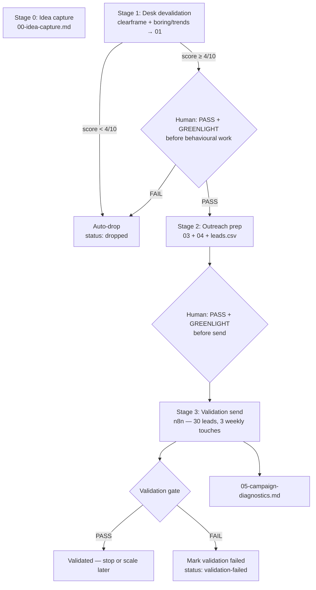

# Hermes — Implementation Plan v2

Stand: 2026-07-08. Supersedes the Stage 2 landing-page design in
[`IMPLEMENTATION-PLAN.md`](IMPLEMENTATION-PLAN.md) for **pipeline behaviour**.
Infra sections (n8n, Mailgun, Postgres, legal) from v1 remain valid unless
noted below.

## 0. Design goal (one sentence)

**Kill bad B2B solo-business ideas (micro-SaaS, productized service, consulting) as fast and automatically as possible; only spend outreach or manual human effort on ideas that survived desk devalidation.**

Out of scope for v2: pivot loops, landing-page branches, scale campaigns,
post-validation optimization paths.

---

## 1. What changed from v1

| v1 | v2 |
|---|---|
| Stage 2 = Carrd + Google Ads smoke test | **Removed** (B2C-oriented, wrong motion) |
| Stage 4 = sales drip (30 calls / 1 preorder) | **Stage 3 = validation send** (30 leads × 3 weekly touches, reply/click gate) |
| `GREENLIGHT` after every stage pass | **`GREENLIGHT` only before behavioural work** (prep + send) |
| Stage 1 `< 4/10` stop + wait for human | **`< 4/10` auto-stop** (no `GREENLIGHT` needed to drop) |
| Stage 3 reads `02-landing-page-test.md` | Stage 2 prep reads **`01` only** |
| Lead list 20–200 before validation | **20–50 leads in CSV; enroll max 30 for validation** |

**Basis repo:** `/Users/julianberlow/dev/hermes-idea-to-outreach-workflow`  
**Stage 1 skills:** `clearframe-devalidation` + `boring-and-trends-check` (unchanged).  
**Not in v2:** IVA 11-skill chain from the `stage1-validation-chain` worktree.

---

## 2. Pipeline (v2)

### Stage numbering vs artifacts

Stages are renumbered; **artifact filenames stay as in v1** (minus `02`) to
limit churn:

| Stage | Workflow file | Primary artifacts |
|---|---|---|
| 0 | (manual) | `00-idea-capture.md` |
| 1 | `workflows/1-devalidation.md` | `01-devalidation-report.md` |
| 2 | `workflows/2-outreach-prep.md` | `03-icp-and-positioning.md`, `04-outreach-plan.md`, `leads.csv` |
| 3 | `workflows/3-validation-send.md` | Postgres state + `05-campaign-diagnostics.md` |

`02-landing-page-test.md` is **removed** from the pipeline (skill +
workflow archived under `_deprecated/`).

---

## 3. Gate rules (v2)

### Stage 1 — desk devalidation

1. Run `clearframe-devalidation` → score 0–10.
2. **If score `< 4/10`:** write `01` with `NO-GO`, set `00` frontmatter
   `status: dropped`, **stop immediately**. Do not run `boring-and-trends-check`.
   **Do not ask for `GREENLIGHT`.**
3. **If score `≥ 4/10`:** run `boring-and-trends-check`, assemble `01`.
4. Human review: `PASS` / `PASS WITH CHANGES` / `FAIL`.
   - `FAIL` → `status: dropped`, stop.
   - `PASS` / `PASS WITH CHANGES` → wait for **`GREENLIGHT NEXT STAGE`** before
     any Stage 2 (outreach prep) work.

### Stage 2 — outreach prep

Same skill chain as v1, orchestrated by [`workflows/2-outreach-prep.md`](workflows/2-outreach-prep.md):

1. `icp-profiler` → `value-props` → `competitive-wedge` → `gtm-mode-selector` → `03`
2. `outreach-assets` → `lead-list-builder` → `04` + `leads.csv`

**Input change:** all skills read **`01` only** (no `02-landing-page-test.md`).

**Prep constraints:**

| Field | v2 default |
|---|---|
| `leads.csv` row count | **20–50** hand-picked |
| Drip angles in `04` | **3 angles** — Week 0 / Week 1 / Week 2 (7-day intervals) |
| Tone | Sales-style outreach + **founder-validation disclaimer** on Touch 0 (*"Ich arbeite an einem neuen Produkt … liege ich falsch?"*) |
| 1PMP | Full six bullets |

Human review + **`GREENLIGHT NEXT STAGE`** required before Stage 3 send.

### Stage 3 — validation send

**Purpose:** behavioural devalidation via founder-led cold e-mail. Full 3-touch
weekly sequence for diagnosis (subject → copy → offer). Sounds like sales to the
recipient; honest validation framing in Touch 0.

**Enrolment cap:** import up to 50 leads from CSV; enroller selects **at most 30**
(highest `icp_score`). **No SQL** — Workflow 0 auto-creates `outreach_config`
on CSV upload; enroller hard-caps at 30.

**Send pattern:**

- **3 touches**, one per **week** (7-day intervals): Week 0 → Week 1 → Week 2.
- Reply-stop: reply → suppress, stop sequence (may reduce total sends below 90).
- Up to **90 sends** (30 leads × 3 touches).

**Validation pass criteria:**

| Signal | Threshold | Notes |
|---|---|---|
| **Reply** (hard) | **≥ 1** substantive reply | Early pass allowed |
| **Click** (soft) | **≥ 3** human clicks | Early pass allowed; weak if 0 replies |

**Verdict logic:**

- **PASS (early):** ≥ 1 reply OR ≥ 3 clicks — anytime during the sequence.
- **FAIL:** full 3-touch sequence complete for **all** enrolled leads, still
  **0 replies AND < 3 clicks** → `status: validation-failed`.
- **INCOMPLETE:** sequence still running, thresholds not met.
- **Stop:** complaint rate > 0.1%.

**Not v2 KPIs:** 30 discovery calls, ≥ 1 preorder.

---

## 4. Stage 1: why keep CLEARFRAME (not IVA chain)

For the v2 goal (**kill fast + automatic**), the dev-repo Stage 1 is sufficient:

| | CLEARFRAME + boring/trends (v2) | IVA 11-skill chain (worktree) |
|---|---|---|
| Agent time per idea | **Low** (~2 skills) | High (~11 skills + JSON) |
| Auto-kill trigger | **Yes** (`< 4/10`, no human needed) | Yes (`drop` `< 40/100`) |
| Catches bad distribution | Partial (CLEARFRAME **R**eachability) | Strong (`distribution.json` mandatory) |
| Token cost | **Low** | High |
| Fit for v2 scope | **Yes** | Overkill until scale path exists |

**When IVA would matter later:** if CLEARFRAME passes ideas that fail validation
repeatedly because reachability or unit economics were hand-waved — then port
`distribution-analysis` + `idea-scoring` only, not the full chain.

---

## 5. Repo changes required (implementation checklist)

### Workflows

- [x] `workflows/1-devalidation.md` — auto-stop on `< 4/10`; `GREENLIGHT` only after
  `≥ 4/10` pass; next step → outreach prep (not landing page).
- [x] `workflows/2-outreach-prep.md` — reads `01` only; 20–50 leads; 3-step weekly drip.
- [x] `workflows/3-validation-send.md` — validation gate; full sequence; no SQL setup.
- [x] Archive `workflows/2-landing-page-test.md` → `workflows/_deprecated/`.
- [x] Rename workflows to match stage numbers.

### Routers

- [x] `CLAUDE.md`, `AGENTS.md`, `README.md` — stage map v2, remove Stage 2 landing.

### Skills

- [x] `skills/icp-profiler/SKILL.md` — reads `01` only (drop `02`).
- [x] `skills/lead-list-builder/SKILL.md` — default **20–50** rows for validation.
- [x] `skills/outreach-assets/SKILL.md` — 3-step founder-validation drip + Energieberater pattern.
- [x] `skills/campaign-diagnostics/SKILL.md` — validation verdict line (pass/fail
  against reply/click thresholds, not 30-call KPI).
- [x] Archive `skills/landing-page-brief/` → `skills/_deprecated/`.

### Templates

- [x] `ideas/_TEMPLATE/` — remove `02-landing-page-test.md`.
- [x] `01-devalidation-report.md` — RAT section points to **Stage 3 validation send**
  (not landing page).

### n8n

- [x] Workflow 0 auto-creates `outreach_config` on CSV import (no operator SQL).
- [x] Enroller: max 30 leads per campaign.
- [x] Sender: 3-step weekly drip (7-day intervals); Reply-Stop unchanged.
- [x] Workflow 5 / diagnostics: validation PASS/FAIL (early or after full sequence).

### Legal (unchanged)

- UWG §7(2) / GDPR: small hand-picked lists, 1:1 tone, opt-out — see v1 §7.
- Validation is still real email; legal checklist before first send.

---

## 6. Explicitly out of scope (v2)

- Landing page as validation alternative
- Post-validation pivot / iterate loops
- Scale campaign (full 20–200 drip to sales KPIs)
- IVA skill chain merge
- Idea generation workflow
- Apollo enrichment (V2)

Revisit when validation PASS rate justifies a **v3 scale stage**.

---

## 7. Success criteria for v2 implementation

1. Idea with CLEARFRAME `< 4/10` stops with `status: dropped` **without** `GREENLIGHT`.
2. Idea with `≥ 4/10` does not reach lead-list work without **`GREENLIGHT`**.
3. No workflow step reads or writes `02-landing-page-test.md`.
4. Validation enrolls ≤30 leads, runs full 3-touch weekly sequence, writes PASS/FAIL to `05`.
5. Stage 2 prep skill chain unchanged in **structure** (same six skills as v1).

---

## 8. Migration note (worktree branch)

The `stage1-validation-chain` worktree contains useful reference material
(IVA ports, sample run) but **is not the v2 baseline**. Cherry-pick only if a
future v3 needs richer Stage 1; do not merge it for v2 kill-speed work.
