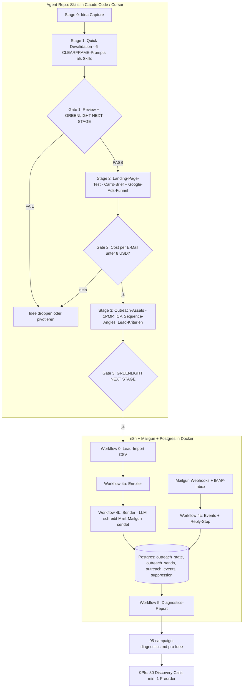

# Hermes: Idea-to-Outreach Workflow — Implementierungsplan

Stand: 2026-07-07. Greenfield-Projekt, Workspace ist leer.

## 0. Grundsatzentscheidungen (aus der Klärungsrunde)

| Entscheidung | Ergebnis |
|---|---|
| Stage 1–3 Ausführungsform | **Skill-basiert** (Markdown-Skills für Claude Code / Cursor / Codex), Vorbild: `Julian7133/idea-validation-agents` + `AkoliteZA/hermes-agent-idea-workflow`. Keine Python-Engine. |
| Stage 1 Inhalt | Die 6 "WEG Quick Devalidation"-Prompts (CLEARFRAME, Market Reality Evaluator, ICP, Value Props, Competitive Wedge, GTM Mode Selector) werden als Skills portiert — nicht die Blueprint-Vorschläge der anderen LLM. |
| Human Gate | Override-Phrase `GREENLIGHT NEXT STAGE` + `PASS / PASS WITH CHANGES / FAIL`-Review-Modell aus dem hermes-agent-Repo. |
| Sendepfad Stage 4 | **n8n direkt → Mailgun HTTP API** (ohne ListMonk). Begründung siehe Abschnitt 5.1. |
| Sequenz | **3-Stufen-Drip** (Tag 0 / 3 / 5) mit Reply-Stop, wie im Mfrostbutter-Template. Die `03-email-sequence.json`-Struktur der anderen LLM wird verworfen; Quelle der Wahrheit ist Postgres. |
| Lead-Beschaffung | Ja, Teil der Pipeline. V1: kuratierter CSV-Import (IndieHackers / LinkedIn / Job Boards, 20–200 Kontakte). V2 (optional): Apollo-Enrichment + ICP-Scoring nach dem Muster des `apollo-lead-enrichment`-Templates. |
| Infrastruktur | Lokal via Docker Compose (n8n + Postgres). Hosting-Entscheidung wird vertagt (n8n-Hosted-Plan läuft Ende Juli aus). |
| Sende-Domain | Dedizierte Subdomain von `berlow.de` (Empfehlung: `out.berlow.de`), siehe Abschnitt 5.2. |
| Verworfen | `the-convocation/openclaw` (existiert nicht, 404), Local-File-Trigger, `03-email-sequence.json`, Supabase. |

## 1. Gesamtarchitektur



Kernprinzip (aus dem Blueprint übernommen): jede Stage konsumiert das harte Artefakt der vorherigen Stage. Die Stage-1–3-Artefakte leben als Markdown im Repo, der Stage-4-Zustand lebt in Postgres, der Diagnostics-Report schließt den Kreis zurück ins Repo.

## 2. Repository-Layout

```text
hermes-idea-to-outreach-workflow/
├── AGENTS.md                     # Intent-Router (Codex), nach Vorbild idea-validation-agents
├── CLAUDE.md                     # dito für Claude Code
├── .cursor/rules/                # eine .mdc pro Skill (Cursor)
├── skills/                       # kanonische Skill-Definitionen (SKILL.md pro Ordner)
│   ├── clearframe-devalidation/  # Prompt 1 + 2 (CLEARFRAME + Market Reality Evaluator)
│   ├── icp-profiler/             # Prompt 3 (JTBD, Awareness Levels, Hormozi ...)
│   ├── value-props/              # Prompt 4
│   ├── competitive-wedge/        # Prompt 5
│   ├── gtm-mode-selector/        # Prompt 6
│   ├── boring-and-trends-check/  # Boring/Nische-Kriterium + 2-Trends-Check (1 soziologisch, 1 technologisch)
│   ├── landing-page-brief/       # Carrd-Copy + Google-Ads-Funnel + Mess-Setup (Stage 2)
│   ├── outreach-assets/          # 1PMP + Drip-Angles + Offer/Voice-Config für n8n (Stage 3)
│   ├── lead-list-builder/        # Suchstrategie + CSV-Schema für handverlesene Leads (Stage 3)
│   └── campaign-diagnostics/     # SQL-Auswertung → Markdown-Report (Stage 4-Abschluss)
├── workflows/                    # Markdown-Orchestrierungen (Stage-Abfolge + Gates)
│   ├── 1-devalidation.md
│   ├── 2-landing-page-test.md
│   ├── 3-outreach-prep.md
│   └── 4-campaign-execution.md
├── ideas/<idea-slug>/            # gestaffelte Artefakte pro Idee (siehe Abschnitt 3)
├── memory/                       # user_profile.md, market_insights/ (wie Referenz-Repo)
└── n8n/
    ├── docker-compose.yml        # n8n + Postgres 16
    ├── .env.example              # Mailgun-Keys, DB-Passwort, Webhook-Signing-Key
    ├── sql/outbound.sql          # angepasstes Schema (siehe Abschnitt 4)
    ├── workflows/
    │   ├── 0-lead-import.json    # CSV → leads-Tabelle
    │   ├── 4a-enroller.json      # adaptiert von Mfrostbutter (ohne ListMonk)
    │   ├── 4b-sender.json        # adaptiert: LLM-Copy + Mailgun /messages
    │   ├── 4c-events.json        # Mailgun-Webhooks + IMAP-Reply-Stop
    │   └── 5-diagnostics.json    # Aggregation → Markdown-Summary
    └── README.md                 # Setup-Anleitung inkl. DNS-Checkliste
```

## 3. Artefakte pro Idee (Stage 0–3, skill-basiert)

Namensschema nach `hermes-agent-idea-workflow`, Inhalte nach deiner Strategie:

| Artefakt | Stage | Inhalt | Gate danach |
|---|---|---|---|
| `00-idea-capture.md` | 0 | Rohidee, Monetarisierungs-Annahme, Micro-SaaS-Fit | — |
| `01-devalidation-report.md` | 1 | Output der Prompts 1+2 (TAM, Saturation, CAC/CLV, Difficulty-Score, Go/No-Go) + Boring/Trends-Check. Abbruchregel: Bewertung < 4/10 → sofort stoppen (Token sparen). | `GREENLIGHT NEXT STAGE` |
| `02-landing-page-test.md` | 2 | Carrd-Brief (Copy generiert aus 01), Google-Ads-Funnel (Budget 50 USD), Messplan. Nach dem Test: Ergebnis eintragen. | Cost/E-Mail < 8 USD, sonst FAIL |
| `03-icp-and-positioning.md` | 3 | Output Prompts 3–6: ICP, 3 Value Props, Positioning-Wedge, GTM-Mode | — |
| `04-outreach-plan.md` | 3 | 1PMP, 3 Drip-Angles (Tag 0/3/5), Offer/CTA/Voice-Block (wird 1:1 in den n8n-Config-Node kopiert), Lead-Suchkriterien + CSV | `GREENLIGHT NEXT STAGE` → Kampagne starten |
| `05-campaign-diagnostics.md` | 4 | Vom Diagnostics-Workflow generiert (siehe Abschnitt 6) | KPI-Check: 30 Calls / 1 Preorder |

Regeln (aus den Referenz-Repos übernommen): Skills rufen einander nicht auf; der Orchestrator (Workflow-Markdown) reicht Artefakte weiter. Alle Outputs sind strukturiert (Markdown/JSON). Ideen-Ordner werden nie gelöscht, nur `status: dropped`.

## 4. Datenmodell (Postgres, adaptiert von `Mfrostbutter/cold-email-outbound`)

Schema `hermes_outreach`. Änderungen gegenüber dem Original:

1. **`leads` ersetzt `gms_leads_enriched`** — generische Tabelle für kuratierte Kontakte: `id, campaign, email, first_name, company, title, domain, source (csv|apollo), icp_score, notes, created_at`. Kein Google-Maps-Bezug (das Original-Template zielt auf Local Businesses, unser ICP sind Micro-SaaS-Zielkunden).
2. **`outreach_state`** — unverändert übernommen, nur `listmonk_subscriber_id` entfällt. Status: `in_sequence | replied | bounced | unsubscribed | completed | suppressed`.
3. **`outreach_sends`** — unverändert (append-only, `provider_message_id` = Mailgun Message-ID als Event-Matching-Key).
4. **`outreach_events` (neu)** — für die granulare Diagnose, die das Original nicht hergibt: `id, send_id → outreach_sends, event (delivered|opened|clicked|bounced|complained|unsubscribed), recipient, url (bei Click), client_name, device_type, is_bot boolean, occurred_at, raw jsonb`. Bot-Erkennung siehe Abschnitt 6.
5. **`suppression`** — unverändert (global, Grund: `replied | bounced | complaint | unsubscribed | manual`).
6. **`outreach_config`** — unverändert (daily_send_cap, max_new_per_day, send_window, min_gap_seconds). Startwerte konservativ: cap 10/Tag, Warm-up über 2–3 Wochen auf max. 40.

## 5. Stage 4: n8n + Mailgun

### 5.1 Entscheidung: direkt Mailgun statt ListMonk

| | n8n → Mailgun direkt (gewählt) | n8n → ListMonk → Mailgun (Template) |
|---|---|---|
| Infrastruktur | 2 Container (n8n, Postgres) | 3 Container + ListMonk-Konfiguration |
| Unsubscribe | Mailgun nativ: `%unsubscribe_url%`-Variable, List-Unsubscribe-Header, eigene Suppression-Liste | ListMonk-Footer + Subscriber-Verwaltung |
| Tracking | Mailgun Open/Click-Tracking + Webhooks (brauchen wir ohnehin) | doppelt (ListMonk und Mailgun tracken beide) |
| Nutzen bei 20–200 Kontakten | ausreichend | Overkill; ListMonk lohnt ab Newsletter-/Listen-Betrieb |

ListMonk ist gute Open Source, löst hier aber kein Problem, das Mailgun nicht schon löst — und kostet einen zusätzlichen Dienst samt Subscriber-Sync (der 4a-Enroller wird dadurch sogar einfacher). Falls später ein Newsletter dazukommt, lässt sich ListMonk nachrüsten, ohne das Datenmodell anzufassen.

### 5.2 Mailgun- und DNS-Setup

- **Sende-Domain: `out.berlow.de`** (dedizierte Subdomain, nie die Hauptdomain — Empfehlung des Templates und Mailgun-Best-Practice). Begründung: die Subdomain erbt etwas Grundvertrauen der Root-Domain (hilft bei kleinem Volumen), isoliert aber die Sender-Reputation weitgehend. Strengere Alternative — separate Wegwerf-Domain (z. B. `berlow-hq.de`) — ist bei 20–200 sorgfältig personalisierten Mails nicht nötig und startet mit Null-Reputation.
- DNS bei deinem Provider: SPF (TXT auf `out.berlow.de`), DKIM (von Mailgun generiert), DMARC (`_dmarc.out.berlow.de`, Start mit `p=none; rua=...` zum Beobachten, nach sauberem Warm-up auf `p=quarantine`), MX für Bounce-Handling.
- **Custom Tracking-Domain**: CNAME `email.out.berlow.de → mailgun.org`, damit Click-Redirects und Tracking-Pixel unter eigener Domain laufen (Deliverability + Vertrauen).
- Mailgun-Settings: Open- und Click-Tracking aktivieren, EU-Region wählen (DSGVO, Daten bleiben in der EU), Webhook-Signing-Key notieren.
- Webhooks registrieren: `delivered`, `opened`, `clicked`, `permanent_fail`, `temporary_fail`, `complained`, `unsubscribed` → alle auf den 4c-Webhook.
- **Mailgun AUP prüfen**: manche Pläne beschränken Cold Outreach; vor dem ersten echten Versand klären.

### 5.3 Die n8n-Workflows

**Workflow 0 — Lead-Import** (neu): Form-/Manual-Trigger nimmt CSV (Schema aus `lead-list-builder`-Skill) entgegen, validiert E-Mail-Syntax, dedupliziert gegen `leads` und `suppression`, insertet. Optionaler V2-Ast: Apollo-Org-Enrich + ICP-Scoring + Credit-gated Reveal, übernommen aus `2-apollo-lead-enrichment.json` (nur der Enrichment-Teil, kein Google-Maps-Scrape).

**Workflow 4a — Enroller** (adaptiert, stündlich): liest `outreach_config`, selektiert Leads (`email NOT IN suppression`, `id NOT IN outreach_state`, optional `icp_score >= min_score`), limitiert auf `max_new_per_day`, insertet `outreach_state` mit Step 0 und `next_send_at = now()`. ListMonk-Upsert entfällt ersatzlos.

**Workflow 4b — Sender** (adaptiert, alle 15 min innerhalb des Send-Windows):
1. Fällige Leads holen (`status = 'in_sequence' AND next_send_at <= now()`), Daily-Cap und `min_gap_seconds` respektieren.
2. LLM (Anthropic Messages API per HTTP, Modell im Config-Node austauschbar) schreibt Subject + Body aus Lead-Fakten + Step-Angle aus `04-outreach-plan.md`. Prompt erzwingt striktes `{subject, body}`-JSON, verbietet erfundene Fakten; Parse-Fehler → deterministischer Fallback-Text (Template-Verhalten übernommen).
3. Versand via `POST https://api.eu.mailgun.net/v3/out.berlow.de/messages` mit `o:tracking=yes`, `o:tag=<campaign>`, `%unsubscribe_url%` im Footer (+ Impressums-/Adress-Zeile), `v:lead_id=<id>` als Custom-Variable (macht das Event-Matching trivial).
4. Mailgun-Message-ID in `outreach_sends` loggen, `sequence_step++`, `next_send_at` nach Drip-Plan (0/3/5 Tage), nach Step 2 → `completed`.

**Workflow 4c — Events + Reply-Stop** (adaptiert):
- *Mailgun-Ast*: Webhook-Trigger, **Signatur-Verifikation zuerst** (HMAC über timestamp+token mit Signing-Key, sonst 406), dann Event normalisieren, Bot-Flag setzen (siehe 6), in `outreach_events` insertieren. Bei `permanent_fail`/`complained`/`unsubscribed`: `outreach_state` auf Endstatus, E-Mail in `suppression`.
- *IMAP-Ast*: Trigger auf der Absender-Mailbox; Reply matcht per `In-Reply-To`/Empfänger auf den Lead → `status = 'replied'`, Sequenz stoppt sofort, `suppression`-Eintrag mit Grund `replied`. (CRM-Promotion aus dem Template lassen wir weg — kein CRM, bewusste Entscheidung; Replies landen als Zeile im Diagnostics-Report und in deiner Inbox.)

**Workflow 5 — Diagnostics** (neu, manuell oder täglich): führt die Aggregations-Queries aus Abschnitt 6 aus und schreibt `ideas/<slug>/05-campaign-diagnostics.md`.

## 6. Auswertung und Bot-Filterung

**Apple MPP / Scanner-Problem**: Opens sind seit Apple Mail Privacy Protection systematisch überzählt. Heuristik pro `opened`-Event:
- `client_name` enthält Apple-Proxy-Signaturen oder der Open kommt < 60 s nach `delivered` zusammen mit Opens vieler anderer Empfänger im selben Zeitfenster → `is_bot = true`.
- Security-Scanner (Barracuda, Mimecast, Proofpoint): `clicked`-Events < 30 s nach Zustellung auf *alle* Links gleichzeitig → `is_bot = true`.
- Konsequenz für die Diagnose: **Opens nur als weiches Signal, Clicks und Replies als harte Signale** behandeln.

**Diagnose-Logik** (im `campaign-diagnostics`-Skill kodiert, Output-Format kompatibel zum `01-devalidation-report.md`-Stil):

| Muster | Diagnose |
|---|---|
| Delivered-Rate < 95 % | Deliverability-/Listen-Problem (Bounces prüfen, Warm-up verlangsamen) |
| Open-Rate (bereinigt) < ~25 % | Subject/Absender-Problem |
| Opens ok, Click-Rate < ~3 % der Opens | Copy-/CTA-Problem |
| Clicks ok, keine Replies/Bookings | Angebots-/Zielgruppen-Problem |
| Complaint-Rate > 0,1 % | Sofort stoppen, Zielgruppe/Ton überdenken |

Report enthält pro Kampagne: Funnel-Tabelle (sent → delivered → opened_human → clicked → replied), pro-Empfänger-Tabelle für die "Opens ohne Click"-Abfrage, Diagnose-Absatz, Empfehlung (Iterate Subject / Iterate Copy / Pivot Offer), KPI-Stand (Discovery Calls, Preorders — manuell gepflegtes Feld).

## 7. Rechtliches (DSGVO + UWG) — muss vor dem ersten Versand gelesen werden

- **§ 7 Abs. 2 UWG (Deutschland): E-Mail-Werbung ohne vorherige ausdrückliche Einwilligung ist auch im B2B-Bereich unzulässig** und abmahnfähig. Das ist das größte rechtliche Risiko dieser Pipeline, nicht die DSGVO. Risikominimierung: sehr kleine, handverlesene Listen; strikt individuelle, dialogorientierte 1:1-Ansprache statt Massenmail-Optik; primär Kontakte außerhalb DACH bzw. Kanäle mit bestehendem Kontext (IndieHackers-Kontakte, Job-Board-Antworten = Einwilligung/Anbahnung). Diese Abwägung triffst du bewusst pro Kampagne; der Plan macht compliant Senden zum Default, ersetzt aber keine Rechtsberatung.
- DSGVO: Mailgun EU-Region nutzen + AVV (DPA) mit Mailgun abschließen; Rechtsgrundlage berechtigtes Interesse (Art. 6 Abs. 1 lit. f) dokumentieren (Legitimate-Interest-Assessment als kurze Notiz im Repo); Datenschutzhinweis + Impressum in jedem Mail-Footer verlinken; Tracking sparsam konfigurieren (Open-Pixel ist datenschutzrechtlich heikel — bewusst abwägen, Click-Tracking über eigene Tracking-Domain ist vertretbarer); IPs aus Webhook-Payloads nicht dauerhaft speichern (im 4c-Normalizer verwerfen oder kürzen); Löschkonzept: `leads`/`outreach_events` nach Kampagnenende + 90 Tage purgen, `suppression` dauerhaft behalten (die Unterdrückung ist selbst die Pflicht).
- Landing Page (Stage 2): Impressum, Datenschutzerklärung, Cookie-/Consent-Hinweis für Google Ads Conversion-Tracking.

## 8. Umsetzungsreihenfolge mit Zeitschätzung

| # | Phase | Inhalt | Aufwand |
|---|---|---|---|
| 1 | Repo-Gerüst | `AGENTS.md`/`CLAUDE.md`/`.cursor/rules/`, `workflows/`-Orchestrierungen, `ideas/`-Template, Gate-Mechanik | 1–2 h |
| 2 | Stage-1-Skills | Prompts 1+2 als `clearframe-devalidation`, `boring-and-trends-check`; Abbruchregel < 4/10 | 2 h |
| 3 | Stage-2/3-Skills | `icp-profiler`, `value-props`, `competitive-wedge`, `gtm-mode-selector`, `landing-page-brief`, `outreach-assets`, `lead-list-builder` | 2–3 h |
| 4 | Lokale Infra | `docker-compose.yml` (n8n + Postgres 16), `.env.example`, `sql/outbound.sql` einspielen | 30–45 min |
| 5 | Mailgun + DNS | Subdomain `out.berlow.de` anlegen, SPF/DKIM/DMARC/Tracking-CNAME setzen, EU-Region, Webhooks registrieren. DNS-Propagation abwarten. | 45–60 min (+ Wartezeit) |
| 6 | n8n-Workflows | 0 (Import), 4a, 4b, 4c vom Template adaptieren: ListMonk raus, Mailgun-HTTP rein, `outreach_events` + Bot-Flag, IMAP-Reply-Stop | 3–4 h |
| 7 | Seed-Test | End-to-End mit 3 eigenen Test-Adressen: Versand, alle Webhook-Events, Reply-Stop, Suppression, Unsubscribe-Link | 1 h |
| 8 | Diagnostics | Workflow 5 + `campaign-diagnostics`-Skill, Report-Format gegen `01-…`-Stil validieren | 1–2 h |
| 9 | Trockenlauf Stage 1–3 | Eine echte Idee komplett durch die Skills schicken, Artefakte + Gates prüfen | 1–2 h |

Gesamt: ~12–16 h reine Umsetzung. Kritischer Pfad: Phase 5 früh starten (DNS-Propagation), parallel Phasen 1–3.

Offene Punkte, die den Plan nicht blockieren (später entscheiden): n8n-Hosting nach Ende Juli (Hetzner/eigener Server vs. weiter hosted), Apollo-Enrichment-Ast (V2), Product-Hunt-Timing für mAImomentum, Prompt-Updates aus SaaS4devs / Lenny's Podcast (als TODO im Repo festhalten).
